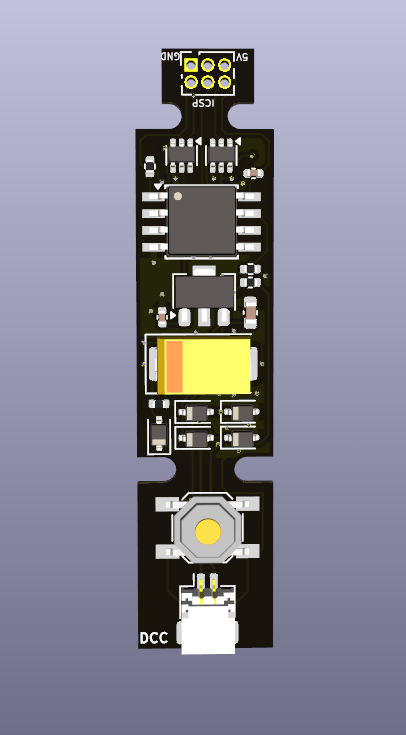
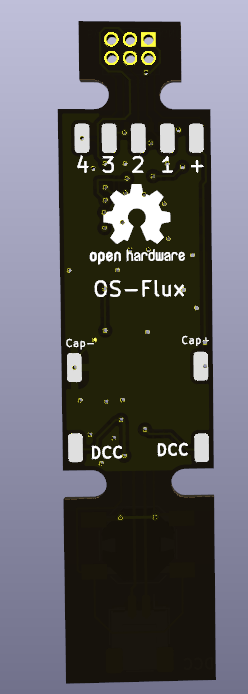
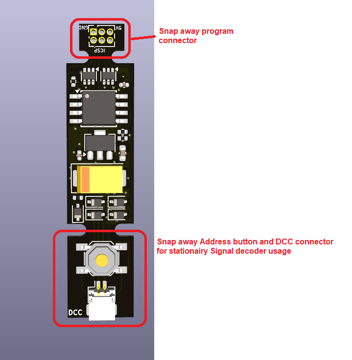
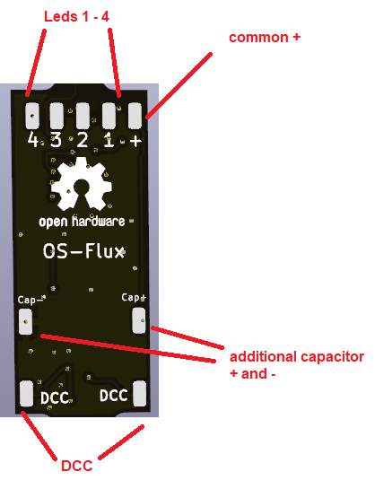
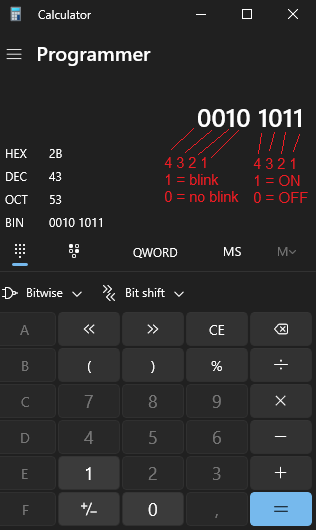

> 🌐 &nbsp; [🇬🇧 EN](Manual-EN.md) &nbsp;|&nbsp; [🇩🇪 DE](Manual-DE.md) &nbsp;|&nbsp; [🇫🇷 FR](Manual-FR.md) &nbsp;|&nbsp; [🇳🇱 NL](Manual-NL.md) &nbsp;|&nbsp; [🇪🇸 ES](Manual-ES.md) &nbsp;|&nbsp; [🇮🇹 IT](Manual-IT.md) &nbsp;|&nbsp; [🇵🇱 PL](Manual-PL.md) &nbsp;|&nbsp; 🇨🇿 CS &nbsp;|&nbsp; [🇩🇰 DA](Manual-DA.md) &nbsp;|&nbsp; [🇳🇴 NO](Manual-NO.md) &nbsp;|&nbsp; [🇸🇪 SV](Manual-SV.md) &nbsp;|&nbsp; [🇭🇺 HU](Manual-HU.md) &nbsp;|&nbsp; [🇵🇹 PT](Manual-PT.md)

# Manuál OS-Flux

 

---

## Úvod

OS-Flux je kompaktní DCC dekodér postavený na mikrokontroléru ATtiny85. Má čtyři LED/funkční výstupy a vejde se přímo do tělesa návěstidla nebo do lokomotivy.

Podle nahraného firmwaru plní jednu ze dvou rolí:

| Firmware | Role |
|---|---|
| **Flux-Signal** | Stacionární dekodér návěstidel — ovládá až 4 LED návěstidla pomocí rozšířených DCC příkazů pro příslušenství (návěsti) |
| **Flux-Mobile** | Funkční dekodér do vozidla — ovládá až 4 funkční výstupy (AUX) v lokomotivě pomocí DCC funkčních příkazů |

Firmware zvolte ještě před programováním. Oba soubory hex se distribuují samostatně.

---

## Přehled desky

Deska má **dvě odlamovací části**.

*Dvě odlamovací části*

### Horní část — programovací konektor

Toto je konektor ICSP, přes který se do ATtiny85 nahrává firmware. Je potřeba jen při programování. **Poté ho odlomte** — v provozu nemá žádný účel a bez něj je montáž čistší.

Kompletní návod k programování najdete zde:
[Nahrání firmwaru do dekodéru OS](https://github.com/Open-Source-Model-Railway-Electronics/docs/blob/master/Program_OS-DCC-Decoder/Program_OS-DCC-Decoder-EN.md)

### Spodní část — tlačítko adresy + konektor JST

Na této části je:

- **Tlačítko** pro nastavení DCC adresy
- **Konektor JST** pro snadné připojení k DCC sběrnici

U dekodéru v návěstidle **tuto část ponechte**. Konektor JST umožňuje návěstidlo připojit k DCC sběrnici a zase odpojit, takže vyjímatelná návěstidla nejsou žádný problém.

Při použití ve vozidle (lokomotivě) lze odlomit i spodní část, pokud překáží.

---

## Pájecí plošky na zadní straně

*Pájecí plošky na zadní straně*

Na zadní straně desky jsou vyvedeny pájecí plošky čtyř výstupů. Jsou elektricky propojené s ploškami na přední straně — použijte tu stranu, která se vám pro montáž hodí lépe.

---

## Programování

1. Stáhněte **Flux-Signal.hex** nebo **Flux-Mobile.hex** ze stránky s vydáními (releases).
2. Připojte programovací část k Arduinu s nahraným ArduinoISP. Kompletní zapojení a návod:
   [Nahrání firmwaru do dekodéru OS](https://github.com/Open-Source-Model-Railway-Electronics/docs/blob/master/Program_OS-DCC-Decoder/Program_OS-DCC-Decoder-EN.md)
3. Nahrajte soubor hex.
4. **Odlomte programovací část.**

---

## Flux-Signal — dekodér návěstidel

### Jak to funguje

Dekodér Flux-Signal ovládá čtyři LED výstupy. Dekodér neví a nezajímá ho, jakou barvu má která LED — to závisí výhradně na tom, jak návěstidlo zapojíte. Pozice bitů jednoduše odpovídají čtyřem fyzickým výstupním ploškám:

| Pozice bitu | Výstupní ploška |
|---|---|
| Bit 0 | LED 0 |
| Bit 1 | LED 1 |
| Bit 2 | LED 2 |
| Bit 3 | LED 3 |

Dekodér přijímá **rozšířené DCC příkazy pro příslušenství** (příkazy pro návěstidla, `notifyDccSigOutputState`) určené jeho nastavené adrese. 8bitová hodnota stavu v tomto příkazu přímo určuje, které LED svítí a které blikají:

| Bity stavového bajtu | Funkce |
|---|---|
| Bity 3:0 (dolní nibble) | Maska návěsti — které výstupy jsou zapnuté |
| Bity 7:4 (horní nibble) | Maska blikání — které z těchto výstupů blikají místo stálého svitu |

Nastavením bitu v masce návěsti příslušný výstup zapnete. Nastavením stejného bitu v masce blikání bude výstup blikat místo stálého svitu. Výstupy, jejichž bit v masce návěsti je 0, jsou vypnuté bez ohledu na masku blikání.

Perioda blikání je **333 ms**.

### Sestavení stavového bajtu

Nejjednodušší způsob, jak sestavit hodnotu stavu, je použít **Kalkulačku Windows v režimu Programátorská se zobrazením BIN**. Přepněte na BIN a zadejte přímo 8 bitů — horní čtyři bity jsou maska blikání, dolní čtyři maska návěsti. Kalkulačka okamžitě zobrazí hodnotu HEX, kterou je třeba odeslat.

*Kalkulačka Windows — režim Programátorská, zobrazení BIN. Horní nibble = maska blikání, dolní nibble = maska návěsti.*

Výše uvedený příklad ukazuje `0010 1011` (hex `0x2B`):

| Nibble | Bity (4 3 2 1) | Význam |
|---|---|---|
| Horní `0010` | nastaven bit 1 | LED 1 bliká |
| Dolní `1011` | nastaveny bity 0, 1, 3 | LED 0 zap., LED 1 zap., LED 2 vyp., LED 3 zap. |

Výsledek: LED 0 svítí stále — LED 1 bliká — LED 2 nesvítí — LED 3 svítí stále.

Když dekodér čeká na naučení nové adresy, všechny čtyři LED blikají a signalizují tak tento režim.

### Výchozí nastavení

| Nastavení | Výchozí hodnota |
|---|---|
| DCC adresa | 1 |
| Režim příkazů | DCC rozšířený (`dccExt = 1`) |

### Nastavení DCC adresy

Podržte **tlačítko na spodní části** po dobu **1 sekundy**. Všechny LED začnou blikat — dekodér nyní čeká na adresu.

Pošlete libovolný DCC příkaz na adresu, kterou chcete přiřadit:

- Pokud pošlete **rozšířený DCC příkaz pro příslušenství (návěst)** — dekodér si adresu uloží a zůstane v rozšířeném režimu (`dccExt = 1`). To je běžný provoz.
- Pokud pošlete **běžný DCC příkaz pro přestavení výhybky** — dekodér si adresu uloží a přepne se do výhybkového režimu (`dccExt = 0`). V tomto režimu již dekodér na rozšířené příkazy pro návěstidla nereaguje. Hodí se, pokud vaše centrála rozšířené příkazy pro příslušenství posílat neumí.

Nová adresa a režim se okamžitě uloží do EEPROM.

---

## Flux-Mobile — funkční dekodér do vozidla

### Jak to funguje

Firmware Flux-Mobile se hlásí jako **multifunkční (lokomotivní) DCC dekodér**. Má čtyři funkční výstupy (AUX), z nichž každý lze propojit s číslem DCC funkce a pomocí programování CV nastavit na různé chování.

Výchozí adresa je **3** (krátká adresa).

### Výchozí konfigurace výstupů

Na nové desce se čtyři výstupy chovají jako běžná přední/zadní světla závislá na směru jízdy plus dva výstupy ovládané funkcemi:

| Výstup | Pin | Výchozí chování |
|---|---|---|
| Aux 0 | 3 | Přední světla — svítí při jízdě vpřed, logicky invertovaný (LED aktivní v log. 0) |
| Aux 1 | 4 | Zadní světla — svítí při jízdě vzad |
| Aux 2 | 1 | Ovládáno funkcí F1 |
| Aux 3 | 0 | Ovládáno funkcí F2 |

### DCC adresa

Nastavuje se standardním programováním CV na programovací koleji:

| CV | Funkce |
|---|---|
| CV 1 | Krátká adresa (1–127) |
| CV 17 + CV 18 | Dlouhá adresa (nejprve zapište CV17, pak CV18) |
| CV 8 = 8 | Obnovení továrního nastavení |

### Tabulka CV výstupů

Každý ze čtyř výstupů má blok 10 CV, začínající od CV 30:

| Výstup | Začátek bloku CV |
|---|---|
| Aux 0 | CV 30 |
| Aux 1 | CV 40 |
| Aux 2 | CV 50 |
| Aux 3 | CV 60 |

V rámci každého bloku:

| Posun | CV (příklad Aux 0) | Název | Popis |
|---|---|---|---|
| +0 | CV 30 | `onDirChange` | 1 = výstup se řídí bitem směru jízdy lokomotivy |
| +1 | CV 31 | `inverted` | 1 = výstup je logicky invertovaný |
| +2 | CV 32 | `number` | Číslo DCC funkce, která tento výstup ovládá (0 = žádná) |
| +3 | CV 33 | `bleeps` | Počet krátkých bliknutí (ve vývoji) |
| +4 | CV 34 | `bleepOn` | Doba zapnutí bliknutí (ve vývoji) |
| +5 | CV 35 | `bleepOff` | Doba vypnutí bliknutí (ve vývoji) |
| +6 | CV 36 | `pulseTime` | Délka impulzu v jednotkách 100 ms (0 = vypnuto) |
| +7 | CV 37 | `slaved` | Kopírování jiného výstupu: zadejte číslo pinu zdrojového výstupu (0 = vypnuto) |
| +8 | CV 38 | *(rezervováno)* | — |
| +9 | CV 39 | `state` | Poslední známý stav výstupu — aktualizuje se automaticky, nezapisujte |

### Logika chování výstupů

Každý výstup v každém průchodu smyčkou vyhodnocuje tyto priority v daném pořadí:

1. **Kopírování** (`CV+7 ≠ 0`) — výstup kopíruje pin zadaný v tomto CV, volitelně invertovaně.
2. **Impulz** (`CV+6 ≠ 0`) — při každé náběžné hraně řídicí funkce výstup vyšle jeden impulz o délce `pulseTime × 100 ms`.
3. **Trvalý** — výstup sleduje stav funkce, volitelně invertovaný pomocí `CV+1`.

Příznak `onDirChange` (`CV+0`) provádí XOR výstupu s aktuálním směrem jízdy lokomotivy. Díky tomu může stejná funkce ovládat různé výstupy podle směru jízdy — přesně tak fungují výchozí přední a zadní světla.
